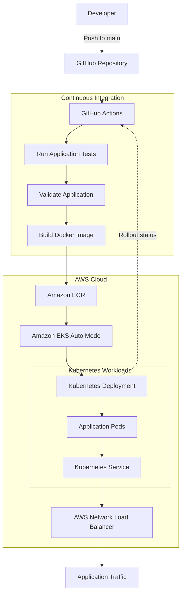

# X-Men Mutant Registry

A production-style DevOps learning project demonstrating containerization, automated CI/CD, AWS infrastructure, Kubernetes reliability, and deployment recovery.

The **X-Men Mutant Registry** explores how to test, package, deploy, and operate a Node.js application using GitHub Actions, Docker, Amazon ECR, and Amazon EKS Auto Mode. It also demonstrates Kubernetes self-healing, deployment rollback, and security-conscious delivery practices.

## Table of Contents

- [Overview](#overview)
- [Architecture](#architecture)
- [Technology Stack](#technology-stack)
- [CI/CD Pipeline](#cicd-pipeline)
- [Container Image Management](#container-image-management)
- [Kubernetes Reliability](#kubernetes-reliability)
- [Failure Testing and Self-Healing](#failure-testing-and-self-healing)
- [Deployment Rollback](#deployment-rollback)
- [Security Practices](#security-practices)
- [Cost Management](#cost-management)
- [Key Learnings](#key-learnings)
- [Project Links](#project-links)

## Overview

The X-Men Mutant Registry is designed to demonstrate core DevOps and cloud-native practices through an automated application delivery workflow.

The project focuses on:

- Automating application testing and deployment.
- Building and publishing Docker images.
- Deploying containerized workloads to Kubernetes.
- Managing application health and resource consumption.
- Demonstrating automated recovery from Pod-level failures.
- Rolling back deployments to previous revisions.
- Applying AWS identity, access-control, and credential-management practices.

The objective is to demonstrate the application lifecycle from a source-code change through to a running Kubernetes workload, including how to respond when a deployment or application instance fails.

## Architecture

### Deployment pipeline

### How the architecture works

1. **Source control:** A developer pushes changes to the GitHub repository.
2. **Continuous integration:** GitHub Actions runs the configured tests and application validation.
3. **Container build:** Docker packages the application and its runtime dependencies into an image.
4. **Image publishing:** The workflow pushes the image to Amazon Elastic Container Registry (ECR).
5. **Kubernetes deployment:** The workflow updates the Kubernetes Deployment to use the new image.
6. **Service exposure:** A Kubernetes Service provides access to the application Pods, with the AWS Network Load Balancer providing the external traffic entry point as configured.
7. **Rollout verification:** The workflow waits for the Kubernetes rollout to complete and reports whether deployment succeeded.

*The diagram represents the intended workflow. The precise traffic path and the connection between the AWS load balancer and Kubernetes Service depend on the deployed Service configuration.*

## Technology Stack

| Category | Technologies |
|---|---|
| Source control | GitHub |
| CI/CD automation | GitHub Actions |
| Containerization | Docker |
| Container registry | Amazon Elastic Container Registry (ECR) |
| Kubernetes platform | Amazon Elastic Kubernetes Service (EKS) Auto Mode |
| Container orchestration | Kubernetes |
| Identity and access | AWS IAM |
| Networking | Amazon VPC, AWS Network Load Balancer |
| Application delivery | Kubernetes Deployments and Services |
| Reliability | Replicas, liveness probes, readiness probes, resource requests and limits |

## CI/CD Pipeline

Every change pushed to `main` triggers the configured GitHub Actions deployment workflow.

### Pipeline stages

1. **Test:** Run the application's automated tests.
2. **Validate:** Check the application before building the image.
3. **Build:** Create a Docker image containing the application.
4. **Publish:** Push the image to Amazon ECR.
5. **Deploy:** Update the Kubernetes Deployment to use the new image.
6. **Verify:** Wait for the rollout to complete and check its outcome.

This process creates a repeatable delivery path from source-code changes to a running application and reduces the need for manual deployment steps.

### Why automate deployment?

- **Consistency:** Deployments follow the same sequence of steps.
- **Traceability:** Image versions can be associated with source-code changes.
- **Faster feedback:** Test and rollout failures can be detected during the workflow.
- **Recoverability:** A previous Deployment revision can be restored using Kubernetes rollout history, provided a suitable revision exists.

## Container Image Management

Amazon ECR stores the Docker images used by the Kubernetes workloads.

The project uses versioned image references to make deployments easier to track and troubleshoot.

### Image management practices

- **Commit-based tagging:** Using a Git commit SHA helps associate an image with the source revision that produced it.
- **Immutable tags:** Enabling ECR tag immutability prevents an existing tag from being overwritten, where the repository configuration enforces it.
- **Version traceability:** A deployment can be inspected to determine which image reference it is running.
- **Controlled image updates:** The Kubernetes Deployment is updated to use the intended image version.

Commit-based image tags are preferable to relying exclusively on a mutable tag such as `latest`, because they make releases easier to identify and reproduce.

## Kubernetes Reliability

Kubernetes manages the application workloads and attempts to maintain the desired state declared in the Deployment.

The project uses Kubernetes reliability features to demonstrate application health management, controlled updates, resource allocation, and container security.

### Reliability configuration

| Feature | Purpose |
|---|---|
| Two replicas | Keeps multiple application Pods configured for the workload. |
| Rolling updates | Introduces application changes incrementally rather than replacing all Pods at once. |
| Liveness probe | Detects containers that should be restarted when the probe fails according to the configured policy. |
| Readiness probe | Determines whether a Pod should receive Service traffic. |
| CPU requests | Specifies the CPU resources requested for scheduling. |
| Memory requests | Specifies the memory resources requested for scheduling. |
| CPU limits | Sets a limit on CPU consumption. |
| Memory limits | Restricts memory usage and can result in termination if the container exceeds its memory limit. |
| Non-root execution | Reduces the privileges available to the application process inside the container. |

These controls demonstrate common Kubernetes practices for managing application availability, container resources, and runtime security.

**Important distinction:** Two replicas improve the opportunity for continued service during a Pod failure, but do not by themselves guarantee high availability. Actual resilience also depends on scheduling, cluster capacity, health checks, application behaviour, and the underlying infrastructure.

## Failure Testing and Self-Healing

A dedicated GitHub Actions **chaos workflow** deliberately deletes an application Pod to simulate a failure.

The test demonstrates Kubernetes reconciliation: the Deployment controller works to bring the number of running replicas back to the declared desired state.

### Expected recovery sequence

1. The workflow deletes a running application Pod.
2. The Deployment temporarily has fewer available replicas than desired.
3. Kubernetes creates a replacement Pod to restore the desired replica count.
4. The replacement Pod starts and runs its configured health checks.
5. Once the Pod is ready, it can receive traffic through the Kubernetes Service.

### Evidence: Pod deletion and recovery

<strong>View Pod failure and recovery screenshots</strong>

**Screenshot 1**

**Screenshot 2**

**Screenshot 3**

**Screenshot 4**

**Screenshot 5**

### What this test demonstrates

- Kubernetes can recreate a deleted Pod managed by a Deployment.
- The controller works to restore the declared replica count.
- Readiness checks help prevent a replacement Pod from receiving traffic before it is ready.
- A controlled failure test provides practical evidence of recovery behaviour.

This is a **Pod-level recovery test**. It does not, by itself, prove recovery from a full cluster, Availability Zone, or application-wide failure.

## Deployment Rollback

A separate GitHub Actions workflow supports deployment rollback using Kubernetes rollout history.

Rollback is useful when a new application release introduces unexpected behaviour or a regression. Where an earlier Deployment revision is available, the rollback workflow can restore that revision.

### Rollback process

1. Identify the Deployment and its available rollout history.
2. Trigger the rollback workflow.
3. Use the Kubernetes rollout mechanism to revert to a previous revision.
4. Wait for the rollback to complete.
5. Inspect the Deployment status and running Pods to verify the outcome.

### Evidence: Deployment rollback

<strong>View rollback workflow screenshots</strong>

**Screenshot 1**

**Screenshot 2**

**Screenshot 3**

**Screenshot 4**

**Screenshot 5**

**Screenshot 6**

**Screenshot 7**

**Screenshot 8**

**Screenshot 9**

**Screenshot 10**

**Screenshot 11**

**Screenshot 12**

**Screenshot 13**

### Why rollback matters

Rollback demonstrates an important operational principle: deployment automation should include a recovery path, not just a mechanism for releasing new versions.

For stronger release verification, a future improvement would combine rollout completion with an application-level smoke test to confirm that the rolled-back version actually serves requests successfully.

## Security Practices

The project incorporates several security-conscious practices across the application delivery pipeline and Kubernetes workloads.

- **GitHub Secrets:** AWS credentials are stored as encrypted repository secrets rather than committed to source control.
- **IAM permissions:** AWS access is controlled through IAM policies and permissions.
- **Image traceability:** Commit-based tags make deployed images easier to identify.
- **ECR tag immutability:** Prevents existing image tags from being overwritten when enabled.
- **Non-root container execution:** Reduces the privileges of the application process.
- **Resource controls:** Kubernetes CPU and memory settings help constrain workload resource consumption.

### AWS authentication

The current project uses an IAM user with access keys stored in GitHub repository secrets. **GitHub Actions OIDC is not currently configured.**

A recommended future improvement is to use OpenID Connect (OIDC) to allow GitHub Actions to assume a narrowly scoped IAM role using short-lived credentials, reducing reliance on long-lived access keys.

### Further security improvements

- Apply least-privilege permissions to the GitHub Actions identity.
- Restrict which GitHub branches and workflows can deploy to AWS.
- Scan container images for known vulnerabilities.
- Keep dependencies and base images updated.
- Review Kubernetes security settings and AWS network access.
- Avoid exposing credentials in workflow logs or application output.

## Cost Management

Amazon EKS and related AWS resources can incur ongoing charges even when the application receives little or no traffic.

Resources to review include:

- EKS cluster and associated compute resources.
- EC2 or other capacity provisioned for workloads, where applicable.
- Network Load Balancers.
- Networking resources and data transfer.
- Amazon ECR image storage.
- CloudWatch logs and monitoring, if enabled.

For a short-lived learning environment, review the resources after testing and remove those no longer needed. Deleting the EKS cluster alone may not remove every related billable resource, so check load balancers, networking components, container images, and other associated resources before considering cleanup complete.

## Key Learnings

This project provided hands-on experience with:

- Building automated CI/CD workflows using GitHub Actions.
- Containerizing a Node.js application with Docker.
- Publishing versioned images to Amazon ECR.
- Deploying workloads to Amazon EKS Auto Mode.
- Managing Kubernetes Deployments, Services, and health probes.
- Applying CPU and memory requests and limits.
- Demonstrating Kubernetes self-healing through deliberate Pod deletion.
- Using Kubernetes rollout history for deployment rollback.
- Managing AWS credentials and IAM permissions.
- Considering security, release traceability, and cloud costs.

The key takeaway is that reliable deployment involves more than building and releasing a container. It also requires understanding the desired state, verifying workload health, testing recovery mechanisms, controlling access, and planning for failed releases.

## Project Links

- [Source code and README](https://github.com/imed3721/xmen-mutant-registry)
- [GitHub Actions workflows and run history](https://github.com/imed3721/xmen-mutant-registry/actions)
